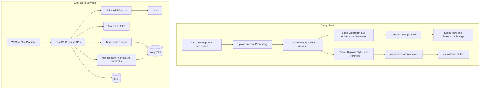

# AI Furniture Design & After-sales Platform

[Back to portfolio](../README.md)

**English** | [简体中文](zh-CN/ai-furniture-platform.md)

## Demo

https://github.com/user-attachments/assets/f14510f4-5126-4eec-a8e8-b27d19577775

Furniture design and service platform demonstration.

> Independent development and integration · CAD and 3D interaction · Generative design · Multimodal after-sales support

## Project Scope

Walls and cabinets can look similar in a CAD drawing. If they are misclassified, the error carries into the visualisation. The design workflow combines geometry and AI-assisted interpretation in an editable 3D model so designers can inspect the layout before generating images. The WeChat after-sales app connects text, image and voice enquiries with tickets that staff can track through resolution.

I independently developed and integrated the applications, including front ends, back ends, design workflows, AI services and deployment. The design tools and Mini Program reside in separate codebases. Existing modules use different storage arrangements; they are not presented as sharing one database or having fully automated data synchronisation.

## Workflows

**Design:** Upload CAD and references → analyse rooms and regions → calibrate scale and build a white model → adjust scene and camera → organise styles and references → generate and inspect visualisations → save scenes and images.

**After-sales:** WeChat login → text, image or speech enquiry → AI response and issue extraction → create ticket → staff follow-up → customer checks progress, confirms resolution and rates service.

## My Contribution

- Developed CAD processing, spatial-image analysis, white-model generation and scene services.
- Built a Three.js workspace for adjusting blocks, saving views and taking screenshots.
- Organised room, region, style and reference-image workflows; integrated vision-language and image-generation capabilities.
- Developed the WeChat application and service backend for AI support, speech, tickets and analysis.
- Configured interfaces, storage and model services, and validated scenes and workflows.

## System Architecture

### Design Modules

| Module | Responsibility and data relationships |
| --- | --- |
| Project and file entry | Accepts CAD, images and PDF documents; organises inputs and outputs by project |
| CAD and reference analysis | Conversion, preprocessing, drawing classification, grid / region analysis and spatial / style cues from reference boards |
| White-model construction | Calibrates scale and converts analysis into editable spatial blocks |
| Scene workspace | Three.js viewing and editing, saved camera views, scene state and screenshots; the lightweight module persists JSON and images |
| Room and region workflows | Associates reference boards, styles, layouts and control images with generation tasks |
| Model adapters | Vision-language analysis and external image-generation services; a simulated path supports workflow validation |
| Output management | Stores visualisations and scene outputs for comparison with drawings, references and spatial structure |

### After-sales Modules

| Module | Responsibility and data relationships |
| --- | --- |
| Client | Native WeChat Mini Program for login, streaming conversations, images, speech, tickets and ratings |
| APIs and authentication | FastAPI / JWT interfaces with WeChat and administrator login |
| Conversation and speech | LLM-based multimodal support and streaming ASR; incremental replies to the client |
| Ticket services | Issue summaries, classification, photos, state transitions, handling records and ratings |
| Management analysis | Tool-based ticket queries, filters, statistics and issue analysis |
| Persistence | PostgreSQL for users, conversations and tickets; Redis caching; Alembic migrations |

## Implementation Highlights

### From 2D Drawings to Editable Spatial Models

Plans and perspective visualisations serve different purposes. The workflow first handles scale, structure and white-model interaction, allowing designers to inspect layouts, adjust blocks and select views before organising image-generation references. The white-model module is a lightweight spatial workspace.

### Turning References into Design Context

Reference boards combine styles, materials, furniture and spatial cues. The workflow organises these by room, region and theme, then connects them to layouts, control images and generation tasks. Space, cabinetry and furnishings can be processed separately to make individual requests manageable.

### Connecting Conversations to Service Resolution

Text, image and speech support continues into ticket classification, handling, progress and customer ratings. Customers can follow an issue, while managers query structured records. AI support is one part of the service workflow.

## Challenges and Responses

### Ambiguity Between Walls and Cabinets in CAD Plans

**Challenge:** Both can appear as elongated rectangles, parallel lines or closed contours against a wall. Shape-only classification can turn cabinets into walls or walls into furniture, propagating errors into white models and generated views.

**Response:** Separately detect room boundaries, internal walls, openings and furniture after preprocessing. Wall rules inspect horizontal / vertical line distribution and continuity; furniture classification considers area, aspect ratio and wall distance. Semantic analysis uses coordinate grids to identify elements and organise functional regions.

**Verification:** Convert results into editable white models so designers can inspect wall, cabinet and circulation relationships. Rules still require adjustment for drawing styles, wall-mounted cabinets and complex storage walls; a single geometric threshold is insufficient.

### Preserving Structure and Scale Through Generation

**Challenge:** Plans encode positions and dimensions; visualisations encode perspective and materials. Generated images can preserve style while changing layout. Cabinet dimensions or openings may drift while the image remains visually plausible.

**Response:** Calibrate scale, build the white model and select views before generation. Manage scene data and images separately, and organise layouts, control images and references by room or region. Separate spatial, cabinetry and furnishing context. White models and screenshots support manual comparison.

### Matching References to Their Intended Locations

**Challenge:** A reference board may mix materials, colours and details from different spaces. Applying all references together can spread a local cabinet requirement across an entire room.

**Response:** Associate analysis, style settings and generation inputs with reference themes, rooms and CAD regions. Designers inspect outputs by region to identify the structure or reference conditions requiring revision.

## Outcomes and Evaluation

Delivered a CAD white-model workspace, interior-visualisation workflows and an after-sales Mini Program. Design modules include APIs, drawing analysis, region processing and workflow validation; service modules cover users, conversations, tickets and administration.

Evaluation can examine spatial consistency, reference retention, designer correction effort, ticket classification and issue resolution. Generated visualisations are not evidence of dimensionally accurate construction drawings.
