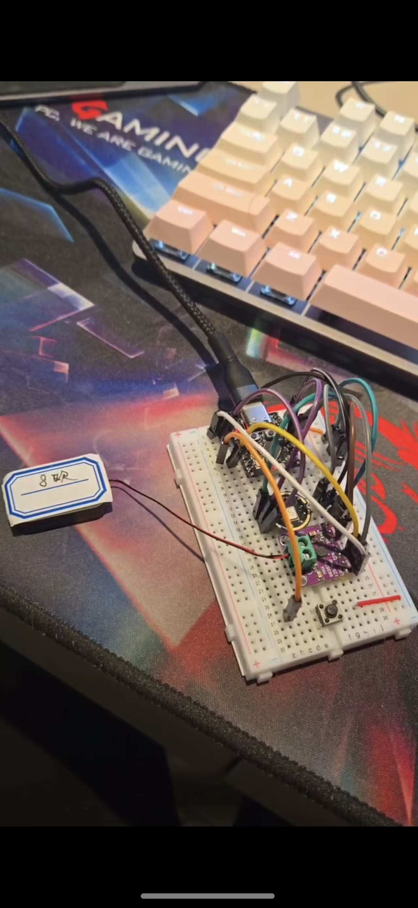
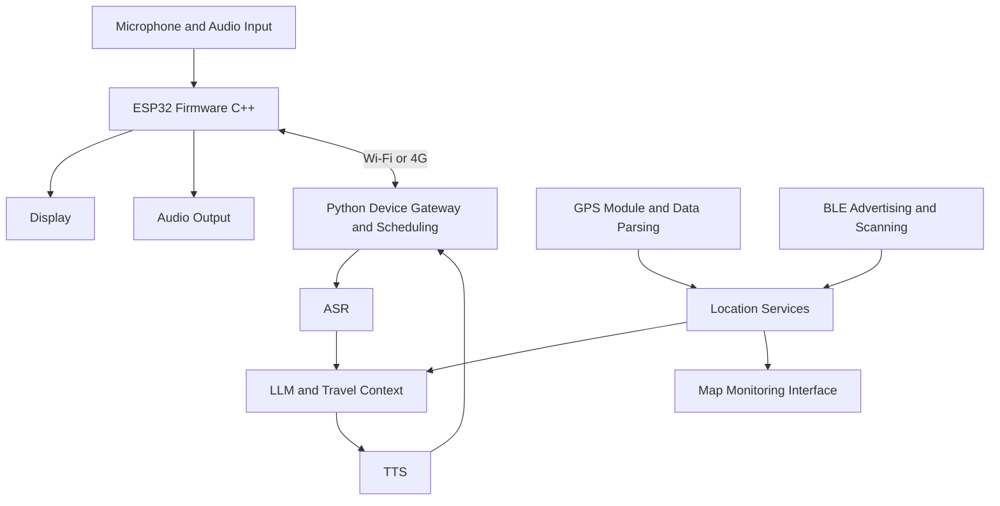

# Embedded AI Travel Companion & Voice Terminal

[Back to portfolio](../README.md)

**English** | [简体中文](zh-CN/embedded-ai-companion.md)

## Demo

https://github.com/user-attachments/assets/fc9c61fb-e71e-4076-965f-23cea5caacbf

Integrated demo: after functional testing, I designed a PCB and assembled the device with a 3D-printed enclosure.

> Independent development and integration · Physical hardware · ESP32 · Speech and location interaction

## Background

For a traveller using the device on the move, a natural pause should not cause a question to be cut off, and waiting too long makes the conversation feel slow. The terminal combines ASR, LLM and TTS with GPS and BLE context. I tuned the end-of-speech decision and tested the voice pipeline over Wi-Fi and 4G.

I independently developed and integrated the terminal application and supporting system, including hardware–software debugging. Breadboard modules first validated audio, communication and conversation flows. After testing, I designed a PCB and used a 3D-printed enclosure to build the integrated demo shown above.

## Hardware Iteration

### Early Test Prototype

Breadboard wiring and separate modules were used to verify functions and hardware–software connections.

### Integrated Demo

Following functional validation, I designed the PCB and assembled a 3D-printed enclosure. The top video shows this later integrated demo; the photograph shows an earlier stage of the same project.

## My Contribution

- Developed and adapted ESP32 firmware for audio, display and networking.
- Completed breadboard validation, PCB design and enclosure integration into a physical demo.
- Connected devices to ASR, LLM and TTS services, iterating Wi-Fi, 4G and streaming versions.
- Developed request scheduling, audio processing, service invocation and interruption handling.
- Integrated BLE data and map monitoring, exploring location-aware conversation.
- Validated local TTS before terminal integration, alongside service and management-interface experiments.

## Hardware and Software Architecture

The diagram summarises module relationships across project iterations. File uploads, persistent connections and streaming speech were validated in different versions; transport mechanisms evolved over time.

| Layer | Implementation and responsibility |
| --- | --- |
| Physical device | ESP32 hardware, audio input / output, display and communication modules |
| Firmware | C++ / Arduino projects, board adaptation, peripherals and networking; uses and adapts open-source ESP32 firmware foundations |
| Communication | Wi-Fi, 4G, HTTP / WebSocket iterations carrying device identities and audio |
| Scheduling | Python / FastAPI for requests, model / speech calls, responses and interruptions |
| Speech pipeline | ASR → LLM → TTS; includes early validation of local synthesis |
| Location and maps | GPS communication and parsing, BLE / iBeacon, scanners, location ingestion and React map interface |
| Supporting materials | Schematics, versioned code, task breakdowns and usage documentation |

## Data Flow

**Audio uplink:** Firmware processes captured audio and sends it through upload or streaming channels. The gateway associates requests with devices, invokes ASR and forwards text to an LLM with travel context.

**Response downlink:** Generated content passes through TTS; the gateway returns audio for device playback. Request, interruption and response states are coordinated across communication and service modules. Iterations include file-based, persistent-connection and WebSocket streaming paths.

**Location branch:** Scanners detect BLE advertisements; location APIs receive observations for maps and conversation context. Location and audio are organised separately and associated with the device by backend services.

## Iteration

### Early Speech Validation

Validated local TTS, model preparation, streaming output and warm-up before terminal service selection and integration. This was an early phase of the same project.

### BLE and Map Validation

Used ESP32 iBeacon, Python scanning and backend APIs to receive device information and display map positions. Browser geolocation, BLE detection and precise indoor positioning are different capabilities; map markers are not presented as validated high-accuracy positioning.

### From Wi-Fi to 4G and Streaming

Versions explored local and server-connected Wi-Fi, 4G integration, persistent 4G connections, partially streamed interaction and full WebSocket streaming recognition. Iteration focused on connecting transport to speech processing and reliable response playback.

## Engineering Highlights

**Device–cloud coordination:** The device handles capture, peripherals and networking; backend services coordinate recognition, generation and synthesis.

**Device-level state:** Device identities associate uploads, service results and interruption states across requests.

**Cross-layer debugging:** A conversation crosses hardware, firmware, networking, ASR, generation and playback. Debugging isolates these layers; version history records the implementation path.

## Challenges and Responses

### End-of-speech Detection Versus Response Latency

**Challenge:** Wake-word activation and free conversation require deciding when a user has finished speaking. Long silence thresholds delay replies; short thresholds mistake pauses for completion and interrupt unfinished speech. This affects input completeness and conversational flow.

**Response:** Tuned voice activity, pause duration and submission timing across wake, listen, submit, wait, play and interrupt states. Tested short and long utterances, mid-sentence pauses and resumed speech to refine waiting behaviour.

**Trade-off:** End detection protects input completeness; pipeline optimisation reduces waiting after speech has ended. Persistent connections and WebSocket streaming reduce serial waits for full uploads and complete results. Thresholds still require adjustment across hardware, networks and speaking habits.

### Locating End-to-end Speech Delays

**Challenge:** Perceived latency includes silence detection, transmission, ASR, generation, TTS and playback preparation. Faster model inference alone cannot resolve all delays, and 4G variability affects the same request differently.

**Response:** Debugged capture, transmission, recognition, generation, synthesis and playback separately. Used service calls, persistent connections, streaming and receive logic to locate delays. Device identities associate requests; interruption states control subsequent processing. Tested speed alongside complete playback and interruption behaviour to preserve conversation order.

### 4G, GPS and Multiple Communication Protocols

**Challenge:** Hardware integration requires matching pins, serial configuration, command timing and payloads. AT-command responses do not establish network registration or application connectivity. Received GPS data must also be distinguished from valid positioning. Failures can originate at any hardware, firmware, network or service layer.

**Response:** Validated serial and AT communication first, then SIM state, registration, signal and connection establishment, followed by TCP / HTTP and application traffic. Debugging code handles expected responses, timeouts and reads. GPS integration separates communication, parsing and business use, with distinct data sources for GPS, BLE and maps.

**Protocol checks:** Verified baud rates, transmit / receive direction, message boundaries, lengths, response formats, timeouts and connection closure across device-to-module, module-to-server and server-to-speech-service links. Display buses and drivers were adapted separately so peripherals could operate together.

## Outcomes and Further Evaluation

Delivered a physical terminal, firmware, speech services, location modules and supporting documentation. Open-source firmware and pretrained speech models provide foundations; application development and integration are my contribution.

Further measurements can cover first-audio response time, network stability, interruption recovery and device resource use. No unmeasured power, battery-life, latency or positioning-accuracy figures are claimed.
