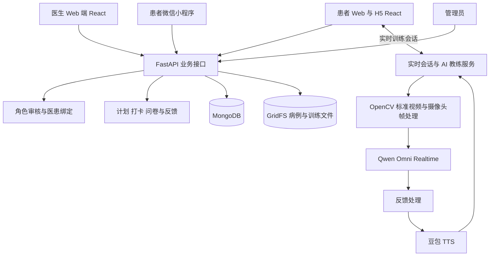

# 医疗康复平台

[返回作品集首页](../README.md)

## 演示视频

> 视频待上传，此处预留页面内播放器。

<!-- 在 GitHub 编辑本文件时，将演示视频拖入此区域，保留上传后生成的视频附件地址。
     以视频附件形式展示，替换上方占位文字；不要改为封面跳转或外部演示系统链接。
     对应项目：医疗康复平台。 -->

> 独立开发 · 实时多模态交互 · 医疗业务系统 · Web / H5 / 微信小程序

## 项目背景

康复训练需要把医生的计划转化为患者能够理解、执行和持续记录的日常动作。本项目将康复计划、训练指导和阶段评估放入同一系统，连接医生的管理工作与患者的训练过程。

我独立完成应用系统开发，将实时视频分析与语音反馈 Demo 扩展到多角色、多端的康复平台。早期 Demo 与后续业务平台属于同一项目的不同阶段。

## 我的工作

- 拆解医生、患者和管理员的使用流程，设计医患关系、康复计划和训练记录。
- 开发 FastAPI 后端、医生 Web 端、患者 Web/H5 与微信小程序。
- 集成实时多模态模型、标准动作视频、摄像头画面及语音反馈。
- 实现训练会话管理、文件存储、训练打卡、反馈和阶段问卷。
- 完成部署配置及系统迭代。基础模型和语音服务通过第三方服务接入。

## 业务流程

1. 医生完成注册审核，患者与医生建立绑定关系。
2. 医生为患者制定个性化康复计划，选择训练项目。
3. 患者查看计划并进入训练，对照标准动作执行。
4. 训练界面采集摄像头画面，AI 服务返回训练反馈与语音指导。
5. 系统记录打卡与反馈，在阶段节点触发评估问卷。
6. 医生查看患者的训练与反馈记录，继续管理康复计划。

## 系统架构

图中实时媒体链路以患者 Web/H5 为例；各客户端按其接口与设备能力接入。

| 层级 | 实现与职责 |
| --- | --- |
| 客户端 | React 医生端和患者端；微信小程序；摄像头采集、计划查看、训练交互 |
| 业务服务 | FastAPI；角色、审核、医患绑定、计划、打卡、问卷、文件接口 |
| 实时训练 | `RehabAICoach` 协调模型连接、图像发送、反馈循环及关闭；`TrainingSessionManager` 管理训练会话 |
| 视频处理 | `StandardVideoPlayer` 与 `FrameProcessor` 管理标准视频及帧处理 |
| AI 与语音 | Qwen-Omni-Realtime 进行多模态分析，豆包 TTS 提供语音输出 |
| 存储 | MongoDB 保存业务记录，GridFS 保存病例与训练文件 |
| 部署 | Nginx 反向代理、HTTPS 与后端服务配置 |

## 模块之间的数据流

**业务数据：** 客户端提交注册、绑定或计划操作，FastAPI 校验角色与医患关系后读写 MongoDB。计划连接患者、医生和训练项目；打卡、问卷及反馈提供持续跟进记录，病例与训练文件通过 GridFS 管理。

**实时媒体：** 患者训练界面采集画面，训练会话服务协调标准动作播放与图像处理，把视觉输入送入多模态模型。反馈循环处理模型结果并连接语音服务，通过实时通道将指导传回界面；连接关闭时释放会话及相关任务。

**运行组织：** 浏览器与小程序承担各自终端交互，Nginx 提供 HTTPS 及反向代理，业务接口和实时会话运行在后端。第三方模型与 TTS 作为独立依赖接入，业务记录和文件存储独立于模型服务维护。

## 实现重点

### 从演示验证到完整业务闭环

早期使用 Python / Tkinter 验证标准视频与摄像头双画面、实时反馈、训练评价及录像。Demo 还提供基于 MMPose 的人物骨架显示选项，用于探索动作呈现方式。随后把实时训练能力纳入 Web 和小程序业务体系，增加角色、计划、打卡与阶段评估。

姿态骨架是早期验证中的技术分支，不把它等同于所有客户端均具备的功能。

### 把视频、模型与语音协调成训练会话

训练同时涉及视频播放、摄像头输入、网络连接、模型反馈和语音播放。后端以训练会话为单位组织这些任务，处理连接建立、图像流、反馈循环及退出清理，避免把每帧分析当作互不关联的请求。

### 将训练数据连接回医生工作流

实时指导之外，平台维护医患绑定、训练计划、每日打卡、患者反馈和 2 / 4 / 6 周阶段问卷，使一次训练成为持续管理过程中的一部分。患者端还提供老年模式，支持大字体和简化界面。

## 核心难点与处理

### 临床使用流程与技术业务模型的对齐

**难点：** 项目落地中，开发者对“完成一次训练”的理解，与医生对康复阶段、动作要求和患者状态的理解存在差异。接口与页面能够运行，并不意味着计划、反馈和评估符合实际使用流程。医生的专业描述还需要转化为患者能够理解的任务和软件能够处理的数据。

**处理：** 围绕医患绑定、计划制定、训练执行、反馈及阶段评估逐项拆解业务，将角色权限、训练项目、打卡和问卷落入具体模块。以实际使用反馈持续校对业务含义和操作顺序，把临床要求转成明确的字段、状态及交互，而不是仅根据开发侧理解一次性固定流程。

**持续优化：** 对需要医生判断的训练要求和阶段评估保留临床解释空间，继续校对软件记录与实际诊疗流程之间的对应关系。

### 摄像头视角与动作角度识别偏差

**难点：** 同一动作在不同拍摄方向、距离及身体朝向下呈现不同的二维投影，遮挡也会影响关键点定位。直接依据画面或模型描述判断动作角度，可能将拍摄差异误判为动作幅度不足。当前角度识别准确性仍是项目的主要技术问题。

**处理基础：** 早期 Demo 接入 MMPose 骨架显示，为观察关键点与动作表现提供技术基础；训练流程保留标准视频与实时画面对照，将视觉输入、反馈逻辑和临床动作要求分别组织。

**修正路径：** 角度修正需要结合关键点几何关系、拍摄视角和动作规范开展算法处理，并与医生对动作的判断核对。优化工作同时需要明确哪些动作和取景条件允许可靠评价，避免将不稳定的图像判断直接表达为确定的训练结论。相关校准与算法修正仍需持续验证，目前不宣称已达到固定的角度测量精度。

### 面向中老年用户的易用性优化

**难点：** 中老年用户在文字阅读、摄像头操作、理解训练指令及连续操作方面存在不同需求。康复训练还涉及动作执行，复杂导航和过多提示会增加使用负担。

**处理：** 患者端提供老年模式、大字体和简化界面；训练环节组合标准动作视频与语音反馈，将计划、进入训练、执行动作和完成打卡组织成清晰路径。医生端保留较完整的管理信息，患者端聚焦当前训练任务，降低两类用户在同一流程中的信息负担。

**持续优化：** 结合实际使用情况调整按钮可见性、提示表达、语音节奏及操作步骤，尤其关注用户能否理解下一步操作和训练反馈。适老化贯穿训练流程与交互迭代。

## 工程成果与评估边界

形成医生端、患者 Web/H5、患者小程序、后端服务及实时训练模块，并保留早期多模态 Demo。该项目展示的是康复辅助软件与交互系统的工程实现；模型反馈不等同于临床诊断，临床疗效、动作判别准确率和患者依从性改善需要专项评估。

值得进一步研究的问题包括动作评价的一致性、反馈时机与端到端延迟，以及老年用户对语音指导的理解和使用体验。这里不将这些问题写成已经取得的研究结论。
