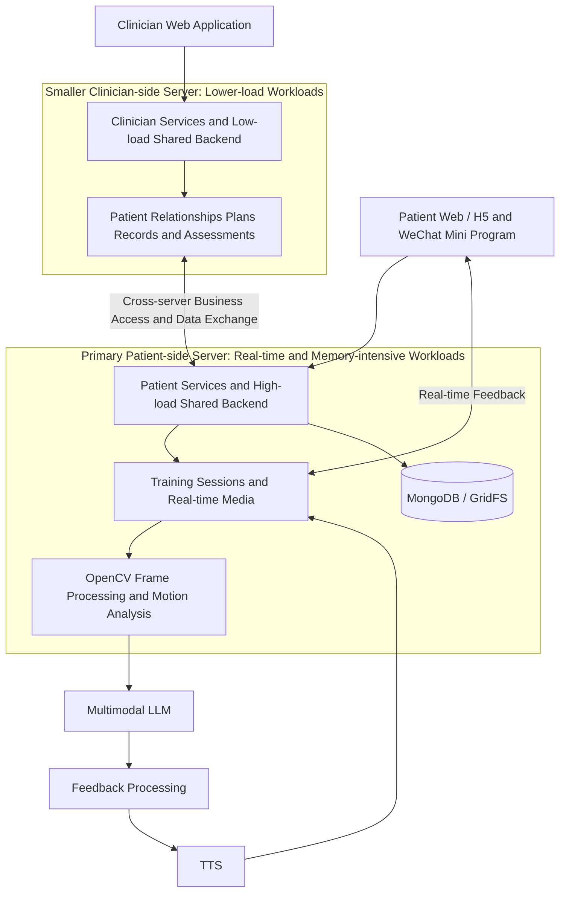

# Medical Rehabilitation Platform

[Back to portfolio](../README.md)

**English** | [简体中文](zh-CN/medical-rehabilitation.md)

## Demo

https://github.com/user-attachments/assets/608758d1-0336-4f7e-a8fc-b27996c7142d

Training motion-recognition demo: passive forward arm elevation, with the participant's face obscured.

> Independent development · Real-time multimodal interaction · Clinical workflows · Web / H5 / WeChat Mini Programs

## Background

Rehabilitation software needs to translate clinician-prescribed plans into exercises that patients can understand, perform and record. This platform brings plans, training feedback and periodic assessments into one workflow, connecting clinical management with everyday patient training.

I independently developed the application system, extending an early real-time video and speech-feedback prototype into a multi-role, multi-client platform. The prototype and subsequent platform are stages of the same project.

## My Contribution

- Translated clinician, patient and administrator workflows into relationships, plans and training records.
- Developed the FastAPI backend, clinician web application, patient Web/H5 application and WeChat Mini Program.
- Integrated multimodal models, reference exercise videos, camera input and speech feedback.
- Implemented training-session management, file storage, check-ins, feedback and periodic questionnaires.
- Implemented two-server deployment, workload-based allocation of shared backend functions and cross-server access optimisation. Foundation models and speech capabilities are integrated services.

## User Workflow

1. Clinicians register and are approved; patients establish a clinician relationship.
2. Clinicians prescribe individual plans and select exercises.
3. Patients open their plans and train alongside reference videos.
4. The application captures camera input and returns AI feedback and speech guidance.
5. The system records check-ins and feedback, triggering questionnaires at assessment milestones.
6. Clinicians review records and adjust ongoing rehabilitation plans.

## System Architecture

The deployment assigns responsibilities according to real-time requirements and memory load. The primary server hosts patient-facing services, the database and demanding shared backend functions. A smaller server hosts the clinician application and lighter shared functions. Shared backend capabilities are divided by responsibility, with cross-server access connecting clinical management to patient data.

| Layer | Implementation and responsibility |
| --- | --- |
| Primary patient-side server | Patient Web/H5 and Mini Program access, training sessions, media processing and high-load shared functions |
| Smaller clinician-side server | Clinician web application, relationships, plans, record review, periodic assessments and lighter shared functions |
| Cross-server access | Connects clinician-side APIs to patient-side data, training records and shared capabilities; optimised request paths and access flows |
| Business services | FastAPI interfaces for roles, approvals, clinician–patient relationships, plans, check-ins, questionnaires and files |
| Real-time training | Session management coordinates model connections, image transmission, feedback loops, state and cleanup |
| Video and motion processing | OpenCV, reference-video playback and camera frames; pose keypoints, angle correction and exercise-specific assessment logic |
| AI and speech | Multimodal LLM analysis and TTS output, described by capability rather than provider |
| Data and files | MongoDB business records and GridFS clinical / training files, centralised on the primary server |
| Access and deployment | Nginx, HTTPS, reverse proxies and backend configuration across both servers |

## Data Flow

**Patient training:** Requests enter the primary server to retrieve plans and establish sessions. The real-time pipeline processes camera frames and reference video; motion analysis and a multimodal LLM produce feedback, with TTS providing speech. Check-ins, questionnaires, feedback and associated files are stored on the primary server.

**Clinical management:** Clinicians use APIs on the smaller server for relationships, plans and assessments. Operations involving patient-side data or shared capabilities access the primary server through cross-server business flows. Management interfaces and real-time training services are organised separately, with centralised storage on the primary server.

**Access optimisation:** After separating deployment, I reviewed request paths between clients, shared APIs and the database, and optimised cross-server calls and data access. Real-time and memory-intensive processing stays on the patient side; the smaller server handles lighter management work. Patient media processing remains within the primary-server training pipeline.

## Implementation Highlights

### From Prototype to an End-to-end Workflow

An early Python / Tkinter prototype validated reference-video and camera views, feedback, training evaluation and recording. An optional pose-estimation skeleton display supported early motion experiments. The project subsequently incorporated roles, plans, check-ins and assessments into web and Mini Program workflows. The early skeleton display is a prototype capability, rather than a feature claimed for every client.

### Coordinating Media, Models and Speech as a Session

Training combines video playback, camera input, network connections, model feedback and audio output. Backend sessions coordinate connection setup, frame transmission, feedback and cleanup, maintaining continuity across the exercise rather than treating frames as unrelated requests.

### Connecting Training to Clinical Follow-up

Clinician–patient relationships, plans, daily check-ins, feedback and questionnaires at weeks 2, 4 and 6 connect individual sessions to ongoing care. The patient interface also provides larger text and a simplified mode for older users.

## Challenges and Responses

### Aligning Clinical Practice with the Software Model

**Challenge:** Developers and clinicians may interpret a completed exercise, rehabilitation stage or patient condition differently. Working pages and APIs alone do not establish that plans, feedback and assessments match practice. Clinical descriptions must become both understandable patient tasks and usable software data.

**Response:** Broke the workflow into relationships, planning, training, feedback and assessments, then mapped requirements to roles, fields, states and interactions. Actual-use feedback informed revisions to business meanings and operation order. Requirements involving clinical judgement remain subject to clinician interpretation and continued review.

### Viewpoint-dependent Motion and Angle Errors

**Challenge:** Camera direction, distance, body orientation and occlusion change observed keypoints and projected angles. Missing or low-confidence joints, mirrored views and affected-side ambiguity can produce unstable measurements. An apparent difference in movement may originate in the camera view.

**Response:** Used pose-estimation experiments and reference / live-video comparison to inspect keypoints and motion. Worked on algorithmic angle correction using joint geometry, viewpoint and exercise requirements. Exercise-specific counting, speed and hold logic also needs to tolerate jitter and timing errors. Calibration and clinical comparison remain ongoing; the project does not claim a fixed validated angle-measurement accuracy.

### Splitting Workloads Without Breaking Cross-server Workflows

**Challenge:** Continuous media processing, model interaction and session state have higher real-time and memory demands than clinician planning and record review. Separating servers also creates access dependencies between clinical operations and patient data, files and training records.

**Response:** Placed patient services, storage and demanding shared functions on the primary server, and clinician services and lighter functions on the smaller server. Reviewed business entry points, request routing and data exchange so clinical management could reach the required records while patient training remained concentrated on the primary server.

### Usability for Middle-aged and Older Patients

**Challenge:** Reading, camera operation, exercise instructions and multi-step navigation create different demands for older users, particularly while they are moving.

**Response:** Added larger text and simplified patient interactions, combining reference video and speech feedback around a clear plan → train → check-in flow. Clinician interfaces retain fuller management information. Button visibility, wording, speech pacing and steps are refined through use.

## Outcomes and Evaluation

Delivered clinician web, patient Web/H5 and Mini Program applications, backend services and real-time training modules, alongside the early prototype. These demonstrate engineering implementation of rehabilitation-support software. Clinical effectiveness, motion-assessment accuracy and adherence improvements require dedicated evaluation.

Further evaluation can examine motion-assessment consistency, feedback timing, end-to-end latency and older users' understanding of guidance. These remain evaluation questions rather than established research findings.
