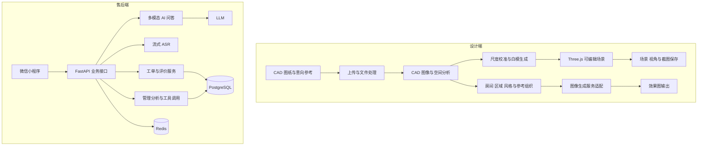

# AI 家具设计与售后服务平台

[返回作品集首页](../../README.zh-CN.md)

[English](../ai-furniture-platform.md) | **简体中文**

## 演示视频

https://github.com/user-attachments/assets/f14510f4-5126-4eec-a8e8-b27d19577775

家具设计与服务平台演示。

> 独立开发与集成 · CAD 与 3D 交互 · 生成式设计 · 多模态售后服务

## 项目定位

这是围绕家具业务开发的整体项目，包含设计端工具和售后服务小程序。设计端连接 CAD 图纸、空间白模、意向参考与效果图生成；售后端连接用户咨询、图片和语音输入、工单处理及管理分析。两部分共同服务家具业务，按各自使用场景组织模块。

我独立完成应用开发与系统集成，涵盖前后端、设计工作流、AI 接入及部署。白模与效果图相关代码、家具小程序保存在不同工程目录，但属于同一项目。现有模块采用不同存储方式，不将它们描述成已经共用一套数据库或自动贯通全部业务数据。

## 业务流程

**设计流程：** 上传 CAD 图纸与意向参考 → 分析空间、房间及区域 → 校准尺度、建立白模 → 调整场景与视角 → 组织风格及参考 → 生成并检查效果图 → 保存场景和图像。

**售后流程：** 微信登录 → 通过文字、图片或语音咨询 → AI 回答并辅助提取问题 → 建立工单 → 管理人员处理 → 用户查看进度、确认与评价。

## 我的工作

- 开发 CAD 文件处理、空间图像分析、白模生成与场景管理服务。
- 开发 Three.js 白模工作台，实现块体调整、视角保存及截图。
- 组织房间、区域、风格和参考图处理流程，接入视觉语言与图像生成服务。
- 开发微信小程序及售后后端，连接 AI 问答、语音、工单与管理分析。
- 完成各模块接口、存储及模型服务配置，并进行场景与流程验证。

## 系统架构

### 设计端模块

| 模块 | 职责与数据关系 |
| --- | --- |
| 项目与文件入口 | 接收 CAD、图像及 PDF 等材料，按项目组织输入文件和处理结果 |
| CAD 与参考分析 | 文件转换、图像预处理、图纸分类、网格与区域分析；从意向板提取空间和风格线索 |
| 白模构建 | 校准尺度，依据图像分析结果生成可编辑空间块体，为查看与调整提供场景数据 |
| 场景工作台 | Three.js 展示与编辑白模，保存视角、场景状态和截图；轻量白模模块通过 JSON 与图像落盘 |
| 房间与区域工作流 | 以房间或区域为单位组织参考板、风格配置、布局及控制图，关联对应的生成任务 |
| 模型服务适配 | 视觉语言服务辅助理解材料，图像生成适配层连接外部生成服务；保留模拟生成路径用于流程验证 |
| 输出管理 | 保存效果图及场景产物，供设计人员对照原图、参考与空间结构检查 |

### 售后端模块

| 模块 | 职责与数据关系 |
| --- | --- |
| 客户端 | 原生微信小程序承载登录、流式对话、图片上传、语音输入、工单进度及评价 |
| 接口与认证 | FastAPI / JWT 组织业务接口，连接微信登录及管理员登录 |
| 对话与语音 | LLM 提供多模态问答，流式 ASR 转写用户语音，回复逐步返回前端 |
| 工单服务 | 从咨询内容提取摘要与分类，保存问题及照片，管理状态流转、处理记录和用户评价 |
| 管理分析 | 通过工具调用查询工单数据，支持筛选、统计及问题分析 |
| 持久化 | PostgreSQL 保存用户、对话及工单业务数据，Redis 提供缓存，Alembic 管理数据结构迁移 |

## 实现重点

### 从二维图纸到可调整的空间表达

CAD 平面图与透视效果图承担不同用途。项目先处理尺度、空间结构和白模交互，再组织图像生成所需参考，让设计人员能够检查布局、调整块体及选择视角。白模模块定位于轻量空间工作台。

### 将参考资料拆成可处理的设计上下文

意向板包含风格、材料、家具和空间位置等不同信息。处理流程按房间、区域及参考主题组织这些内容，再关联布局、控制图与生成任务。空间、定制柜体和软装资料可分阶段处理，减少将全部要求挤进一次生成请求的复杂度。

### 把咨询接入售后闭环

售后小程序保留文字、图片和语音入口，把对话延伸至工单分类、处理记录、进度和评价。用户能够继续跟进问题，管理侧能够基于结构化工单查询和分析，AI 问答成为业务流程的一环。

## 核心难点与处理

### CAD 图纸中墙体与柜体的结构歧义

**难点：** 墙体和柜体在平面图中都可能表现为细长矩形、平行线或贴墙封闭轮廓。若仅按外形分类，柜体容易被识别为墙体，墙体也可能被生成成家具块体，错误会继续传递到空间白模和效果图。

**处理：** 在图像预处理后，将房间边界、内部墙体、开口与家具块体分别检测。墙体检测使用横纵方向的线条分布和连续性，家具分类结合块体面积、长宽比及距墙距离；语义分析则使用带坐标网格的图纸，先识别家具与结构元素，再按元素分布组织功能区域。

**校核：** 把分析结果转成可查看和调整的白模，让设计人员检查墙体、柜体及通行关系后再使用后续输出。现有规则为不同元素提供区分依据，对符号风格变化、贴墙柜与复杂储物墙仍需结合图纸样本调整，不能只依赖单一几何阈值。

### 二维结构、空间尺度与生成结果的衔接

**难点：** 平面图表达位置和尺寸，效果图表达透视及材质。直接生成图像容易保留风格却改变空间布局；柜体尺寸、墙面关系或门窗开口发生偏移时，视觉效果仍可能看似合理。

**处理：** 将尺度校准、白模搭建和视角选择安排在图像生成之前，场景数据与生成图像分别管理。房间及区域工作流组织布局、控制图和参考板，按空间、柜体与软装拆分上下文，使生成任务具有明确的结构与风格输入。白模与截图为人工比对提供参照。

### 意向参考的语义与位置对应

**难点：** 一张意向板可能混合材料、家具、颜色与局部设计，参考内容未必属于同一空间。未经区分地使用全部参考，容易把局部柜体要求施加到整个房间。

**处理：** 通过参考主题、区域和房间组织分析结果，分别建立风格配置和生成输入；在工作流中关联 CAD 区域、参考图与具体任务。设计人员可按区域检查输出，定位需要修改的结构或参考条件。

## 工程成果与评估方向

形成 CAD 白模工作台、家装效果图处理工作流和家具售后小程序等模块。设计端保留 API、图纸分析、区域处理与流程验证代码，售后端形成用户、对话、工单和管理服务。

后续可以分别评估白模空间结构的一致性、参考条件保留程度、设计人员修改成本，以及工单分类和问题解决情况；图像生成效果不直接等同于尺寸准确的施工设计。
