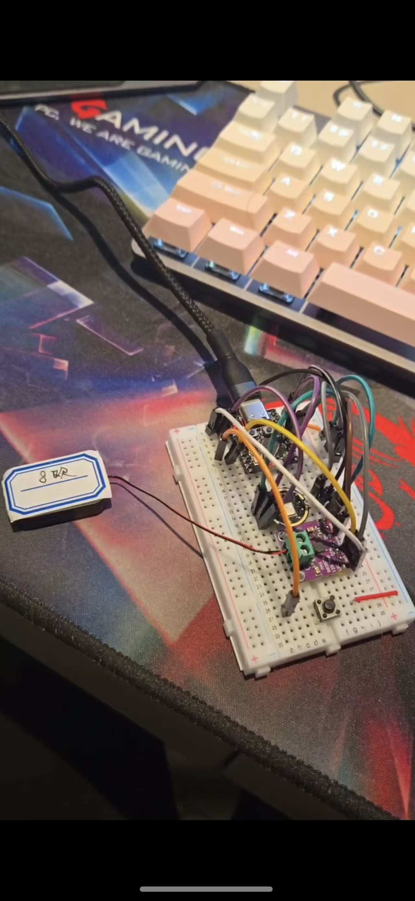
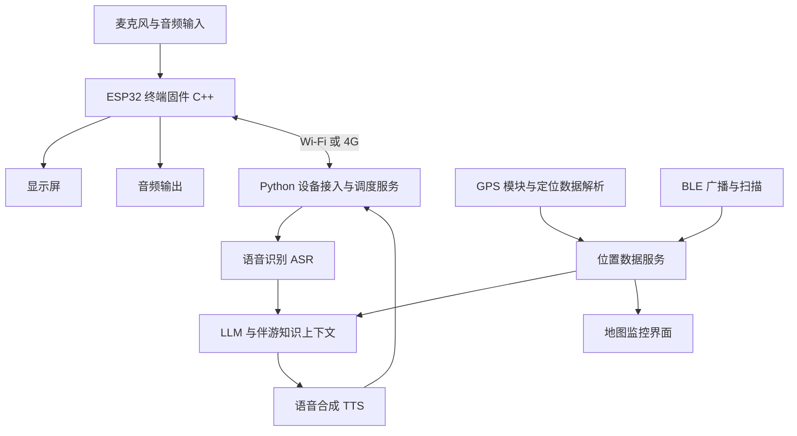

# 嵌入式 AI 伴游终端与语音机器人

[返回作品集首页](../../README.zh-CN.md)

[English](../embedded-ai-companion.md) | **简体中文**

## 演示视频

https://github.com/user-attachments/assets/fc9c61fb-e71e-4076-965f-23cea5caacbf

集成 Demo 演示：功能测试通过后，自行设计 PCB，并使用 3D 打印外壳完成组装。

> 独立开发与系统集成 · 实体硬件 · ESP32 · 语音与位置交互

## 项目背景

本项目以实体终端承载 AI 伴游与语音对话，包含硬件、嵌入式程序、网络通信和后端服务。终端采集音频，通过 Wi-Fi 或 4G 与服务端交互，再将回复以语音播放，并结合 GPS、BLE 与地图提供位置上下文。

我独立完成终端应用与配套系统的开发、集成和软硬件联调。早期采用面包板与模块连线验证音频、通信和对话流程；验证通过后，自行设计 PCB，并制作 3D 打印外壳，形成视频所展示的集成 Demo。

## 硬件迭代

### 早期测试版本

早期使用面包板和分立模块验证功能与软硬件连接。

### 集成 Demo 版本

功能测试通过后，自行设计 PCB，并使用 3D 打印外壳完成组装。顶部演示视频展示这一集成 Demo，与早期面包板测试版本属于同一项目的不同阶段。

## 我的工作

- 开发和适配 ESP32 终端程序，集成音频、屏幕及联网能力。
- 完成早期面包板验证、自设计 PCB 和 3D 打印外壳集成，形成实体 Demo。
- 连接终端与 ASR、LLM、TTS 服务，迭代 Wi-Fi、4G 与流式通信版本。
- 开发设备请求调度、音频处理、服务调用及中断处理逻辑。
- 接入 BLE 数据与地图监控，探索基于位置上下文的交互。
- 完成本地语音合成的前期验证、服务联调和管理界面探索。

## 软硬件架构

架构图概括同一项目的模块关系。历史版本分别验证文件上传、长连接和流式语音，具体通信方式随版本演进。

| 层级 | 实现与职责 |
| --- | --- |
| 实体终端 | ESP32 系列硬件、音频输入输出、显示屏与通信模块 |
| 嵌入式程序 | C++ / Arduino 相关工程，板级适配、外设及网络交互；使用并适配小智 ESP32 等开源底座 |
| 设备通信 | Wi-Fi、4G、HTTP / WebSocket 等版本，传递设备标识和音频数据 |
| 调度服务 | Python / FastAPI；调用语音与模型服务，处理设备请求、结果返回和中断 |
| 语音链路 | ASR 转写 → LLM 生成 → TTS 合成；包含本地合成服务的前期验证 |
| 定位与展示 | GPS 模块接入与数据解析、BLE / iBeacon、扫描程序、位置数据接收及 React 地图界面 |
| 配套材料 | 硬件原理图、版本代码、任务拆解及产品使用说明 |

## 模块之间的数据流

**上行语音：** 麦克风采集音频，固件完成设备侧音频与网络处理，通过对应版本的上传或流式通道发送至服务端。调度层依据设备标识组织请求，调用 ASR 获得文本，再交给带有伴游上下文的模型服务。

**下行回复：** 模型生成内容交给 TTS，调度层返回音频，由终端接收和播放。设备请求、中断及回复状态需要跨通信和服务模块协调，历史版本分别采用文件式、长连接及 WebSocket 流式路径。

**位置支路：** BLE 广播由扫描程序识别，位置接口接收设备及相关观测数据，再供地图界面和对话上下文使用。位置支路与音频主链路分别组织，服务端将其关联到设备，而不是要求地图页面承担语音调度。

## 迭代过程

### 语音能力前期验证

先验证本地语音合成服务、模型准备、流式输出和预热流程，再用于终端项目的服务选型与联调。本地 TTS 验证属于此阶段，不作为额外独立项目计算。

### BLE 与地图验证

使用 ESP32 iBeacon、Python 扫描和服务端接口接收设备信息，在网页地图展示位置。`ESPboe` 与 `BTGPS` 属于本项目的定位分支。浏览器地理位置、BLE 设备检测与精确室内定位是不同能力，作品集不把地图标记描述为已经验证的高精度定位结果。

### 从 Wi-Fi 到 4G 与流式交互

历史版本包含本地 Wi-Fi、服务器 Wi-Fi、4G 集成、4G 长连接、伪流式及全 WebSocket 流式识别。迭代重点是设备通信与语音处理如何衔接，以及终端如何接收和播放回复。

## 工程重点

**终端与云端协同。** 将音频采集、设备交互与服务编排分开，终端负责外设和通信，服务端组织识别、模型与合成任务。

**设备维度的状态处理。** 后端使用设备标识关联请求，处理音频上传、服务返回与中断，避免仅依赖一次网页会话来组织交互。

**跨层联调。** 同一条对话链路涉及硬件、固件、网络、识别、生成和播放，需要按模块定位问题。项目保留不同阶段版本用于记录实现路径。

## 核心难点与处理

### 自由对话中的结束判定与响应速度平衡

**难点：** 终端采用语音唤醒和自由对话交互，需要判断用户何时真正结束发言。静音等待过长会增加回答延迟，过短则会把思考或换气时的停顿当作结束，导致用户尚未说完就开始回复。该问题同时影响交互自然度、识别完整性与首段回复速度。

**处理：** 围绕语音活动判定、停顿等待与发送时机进行阈值调试，把唤醒、监听、提交、等待回复、播放及中断作为相互衔接的交互状态。调试时分别观察短句、长句、句中停顿和重新开口，结合实际对话体验调整等待策略，而不是单纯缩短静音时间。

**工程取舍：** 结束判定负责保护输入完整性，链路优化负责减少判定结束后的等待，两者分别处理。项目从文件式交互迭代至长连接及 WebSocket 流式路径，减少整段音频上传和完整结果返回形成的串行等待；阈值仍需随设备、网络和用户说话习惯持续调整。

### 端到端语音链路的延迟定位

**难点：** 用户感知的响应时间包含结束等待、音频传输、ASR、模型生成、TTS 和终端播放准备。单独加快模型推理，无法覆盖整个链路的等待；4G 网络波动还可能使相同请求出现不同体验。

**处理：** 按设备采集与发送、识别、生成、合成和播放分层联调，结合服务调用、长连接、流式输出及音频接收逻辑定位等待环节。设备标识关联请求，中断状态控制后续处理；测试中同时检查回答速度、语音完整性以及用户再次发言时能否中断，避免速度优化破坏对话顺序。

### 4G 模块、GPS 与多协议联调

**难点：** 硬件接入需要同时校对引脚、串口配置、指令时序和通信数据。4G 模块能够响应指令，不代表已经完成注册、联网及业务传输；GPS 数据接收也需要与有效定位状态和业务使用区分。多个外设与协议叠加后，问题可能发生在硬件连接、固件、网络或服务端任一层。

**处理：** 4G 调试先验证串口与 AT 响应，再逐步检查 SIM 状态、网络注册、信号强度和连接建立，之后验证 TCP / HTTP 及业务链路。已有调试代码组织了指令发送、预期响应等待、超时与返回读取。GPS 接入按设备通信、定位数据解析及业务传递分层校对，并与 BLE 和地图分支区分数据来源，避免混用不同定位信息。

**协议校对：** 联调中核对串口波特率、收发方向、消息边界、发送长度、返回格式、超时及连接关闭时机；分别验证设备到通信模块、模块到服务器、服务器到语音服务的输入输出。屏幕等外设另行完成总线和驱动适配，使显示、定位与语音通信可以在同一终端协作。

## 工程成果与后续评估

形成实体终端、嵌入式程序、语音服务、定位分支与配套说明。相关开源固件和预训练语音模型作为底座使用，应用层开发与集成由我完成。

后续可记录首段语音响应时间、不同网络下的稳定性、打断恢复表现和设备资源占用。当前不列未经测量的功耗、续航、延迟或定位精度。
