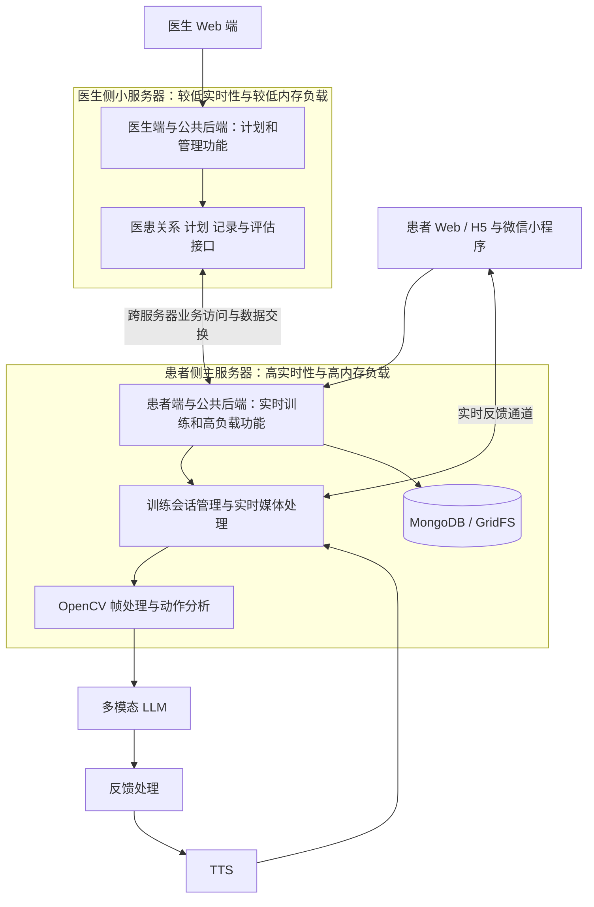

# 医疗康复平台

[返回作品集首页](../../README.zh-CN.md)

[English](../medical-rehabilitation.md) | **简体中文**

## 演示视频

https://github.com/user-attachments/assets/608758d1-0336-4f7e-a8fc-b27996c7142d

康复训练动作识别演示：被动前屈上举（面部已打码）。

> 独立开发 · 实时多模态交互 · 医疗业务系统 · Web / H5 / 微信小程序

## 项目背景

患者离开诊室后，需要知道该练什么、怎么练，医生也需要在复诊时了解实际训练情况。平台把康复计划、标准动作视频、基于摄像头画面的 AI 反馈和训练打卡连在一起，供患者居家训练和医生后续查看。

我独立完成应用系统开发，将实时视频分析与语音反馈 Demo 扩展到多角色、多端的康复平台。早期 Demo 与后续业务平台属于同一项目的不同阶段。

## 我的工作

- 拆解医生、患者和管理员的使用流程，设计医患关系、康复计划和训练记录。
- 开发 FastAPI 后端、医生 Web 端、患者 Web/H5 与微信小程序。
- 集成实时多模态模型、标准动作视频、摄像头画面及语音反馈。
- 实现训练会话管理、文件存储、训练打卡、反馈和阶段问卷。
- 完成双服务器部署、公共后端按负载分工及跨服务器访问流程优化。基础模型和语音服务通过第三方服务接入。

## 业务流程

1. 医生完成注册审核，患者与医生建立绑定关系。
2. 医生为患者制定个性化康复计划，选择训练项目。
3. 患者查看计划并进入训练，对照标准动作执行。
4. 训练界面采集摄像头画面，AI 服务返回训练反馈与语音指导。
5. 系统记录打卡与反馈，在阶段节点触发评估问卷。
6. 医生查看患者的训练与反馈记录，继续管理康复计划。

## 系统架构

按业务的实时性与内存负载划分两台服务器的职责。患者端、数据库及实时性要求高、内存负载高的公共后端功能部署在患者侧主服务器；医生端及实时性要求较低、内存负载较低的公共后端功能部署在医生侧小服务器。公共后端按功能分工部署，跨服务器访问连接医生管理流程与患者训练数据。

| 层级 | 实现与职责 |
| --- | --- |
| 患者侧主服务器 | 承载患者 Web/H5、微信小程序接入、实时训练会话、媒体处理及高负载公共后端功能 |
| 医生侧小服务器 | 承载医生 Web 端及低负载公共后端功能，包括医患管理、计划制定、记录查看与阶段评估 |
| 跨服务器访问 | 连接医生侧业务接口与患者侧数据、训练记录及公共能力；优化请求流向与跨服务器访问流程 |
| 业务服务 | FastAPI；组织角色、审核、医患绑定、计划、打卡、问卷及文件接口 |
| 实时训练 | 会话管理模块协调模型连接、图像发送、反馈循环、会话状态及退出清理 |
| 视频与动作处理 | OpenCV、标准视频播放与摄像头帧处理；姿态关键点、角度修正及动作特定的训练判定 |
| AI 与语音 | 多模态 LLM 分析视觉与会话输入，TTS 提供语音输出；以功能名称描述服务依赖 |
| 数据与文件 | MongoDB 保存业务记录，GridFS 保存病例与训练文件，集中部署在患者侧主服务器 |
| 接入与部署 | Nginx、HTTPS、反向代理及双服务器后端配置 |

## 模块之间的数据流

**患者训练：** 患者端请求进入主服务器，获取训练计划并建立训练会话；摄像头画面和标准视频在实时链路中处理，动作分析及多模态 LLM 返回反馈，TTS 提供语音输出。打卡、问卷、训练反馈及关联文件写入主服务器上的数据库与文件存储。

**医生管理：** 医生端通过小服务器上的接口处理医患管理、计划及评估操作；涉及患者侧数据或公共能力时，通过跨服务器业务访问衔接主服务器。医生侧页面、管理接口和患者实时训练服务分别组织，数据存储集中在主服务器。

**访问流程优化：** 在拆分部署后，重新梳理医生端、患者端、公共接口与数据库之间的请求路径，优化跨服务器调用和数据访问流程。高实时性训练与高内存负载处理留在患者侧，医生侧小服务器承担相对轻量的管理工作；不将患者实时媒体处理转由医生侧服务器中转。

## 实现重点

### 从演示验证到完整业务闭环

早期使用 Python / Tkinter 验证标准视频与摄像头双画面、实时反馈、训练评价及录像。Demo 还提供基于 MMPose 的人物骨架显示选项，用于探索动作呈现方式。随后把实时训练能力纳入 Web 和小程序业务体系，增加角色、计划、打卡与阶段评估。

姿态骨架是早期验证中的技术分支，不把它等同于所有客户端均具备的功能。

### 把视频、模型与语音协调成训练会话

训练同时涉及视频播放、摄像头输入、网络连接、模型反馈和语音播放。后端以训练会话为单位组织这些任务，处理连接建立、图像流、反馈循环及退出清理，避免把每帧分析当作互不关联的请求。

### 将训练数据连接回医生工作流

实时指导之外，平台维护医患绑定、训练计划、每日打卡、患者反馈和 2 / 4 / 6 周阶段问卷，使一次训练成为持续管理过程中的一部分。患者端还提供老年模式，支持大字体和简化界面。

## 核心难点与处理

### 临床使用流程与技术业务模型的对齐

**难点：** 项目落地中，开发者对“完成一次训练”的理解，与医生对康复阶段、动作要求和患者状态的理解存在差异。接口与页面能够运行，并不意味着计划、反馈和评估符合实际使用流程。医生的专业描述还需要转化为患者能够理解的任务和软件能够处理的数据。

**处理：** 围绕医患绑定、计划制定、训练执行、反馈及阶段评估逐项拆解业务，将角色权限、训练项目、打卡和问卷落入具体模块。以实际使用反馈持续校对业务含义和操作顺序，把临床要求转成明确的字段、状态及交互，而不是仅根据开发侧理解一次性固定流程。

**持续优化：** 对需要医生判断的训练要求和阶段评估保留临床解释空间，继续校对软件记录与实际诊疗流程之间的对应关系。

### 摄像头视角与动作角度识别偏差

**难点：** 同一动作在不同拍摄方向、距离及身体朝向下呈现不同的二维投影，遮挡也会影响关键点定位；肩、肘、髋等关键点缺失或置信度不足，以及镜像、左右侧和患侧混淆，都会影响后续角度与动作判断。直接依据画面或模型描述判断动作角度，可能将拍摄差异误判为动作幅度不足。当前角度识别准确性仍是项目的主要技术问题。

**处理基础：** 早期 Demo 接入 MMPose 骨架显示，为观察关键点与动作表现提供技术基础；训练流程保留标准视频与实时画面对照，将视觉输入、反馈逻辑和临床动作要求分别组织。

**修正路径：** 角度修正需要结合关键点几何关系、拍摄视角和动作规范开展算法处理，并与医生对动作的判断核对。优化工作同时需要明确哪些动作和取景条件允许可靠评价，避免将不稳定的图像判断直接表达为确定的训练结论。不同动作的计数、速度与保持判定分别处理，并针对关键点抖动和时间轴误差继续调整。相关校准与算法修正仍需持续验证，目前不宣称已达到固定的角度测量精度。

### 不同负载的服务拆分与跨服务器访问

**难点：** 患者训练涉及持续的视频处理、模型交互和会话状态，对实时性和内存资源的要求高于医生侧的计划制定、记录查询与管理。拆分服务器后，还需要保证医生操作与主服务器上的患者数据、文件和训练记录能够衔接。

**处理：** 将患者端、数据库及高实时性、高内存负载的公共功能放在主服务器，将医生端和低负载公共功能放在小服务器。按业务入口梳理跨服务器访问流程，优化请求路由与数据交换，使医生侧管理流程可以访问所需业务数据，同时保持患者训练链路集中处理。

### 面向中老年用户的易用性优化

**难点：** 中老年用户在文字阅读、摄像头操作、理解训练指令及连续操作方面存在不同需求。康复训练还涉及动作执行，复杂导航和过多提示会增加使用负担。

**处理：** 患者端提供老年模式、大字体和简化界面；训练环节组合标准动作视频与语音反馈，将计划、进入训练、执行动作和完成打卡组织成清晰路径。医生端保留较完整的管理信息，患者端聚焦当前训练任务，降低两类用户在同一流程中的信息负担。

**持续优化：** 结合实际使用情况调整按钮可见性、提示表达、语音节奏及操作步骤，尤其关注用户能否理解下一步操作和训练反馈。适老化贯穿训练流程与交互迭代。

## 工程成果与评估边界

形成医生端、患者 Web/H5、患者小程序、后端服务及实时训练模块，并保留早期多模态 Demo。该项目展示的是康复辅助软件与交互系统的工程实现；模型反馈不等同于临床诊断，临床疗效、动作判别准确率和患者依从性改善需要专项评估。

值得进一步研究的问题包括动作评价的一致性、反馈时机与端到端延迟，以及老年用户对语音指导的理解和使用体验。这里不将这些问题写成已经取得的研究结论。
